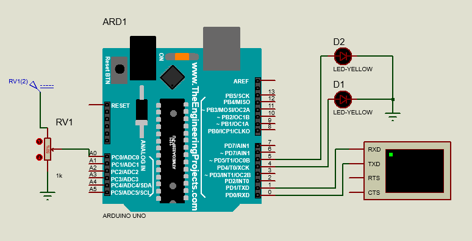
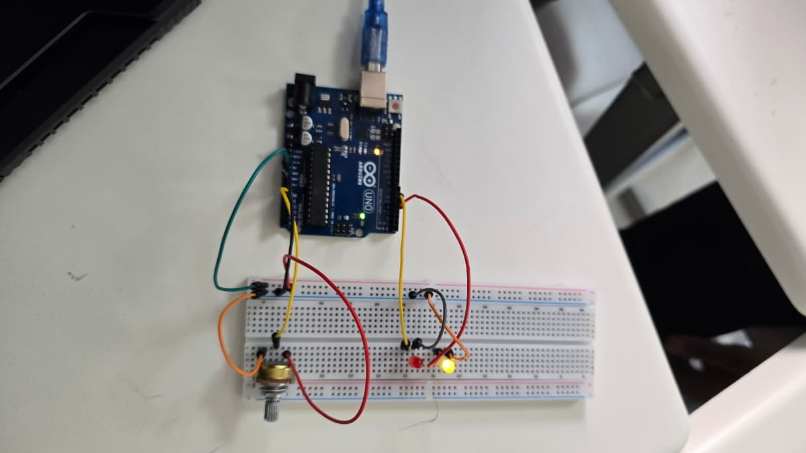
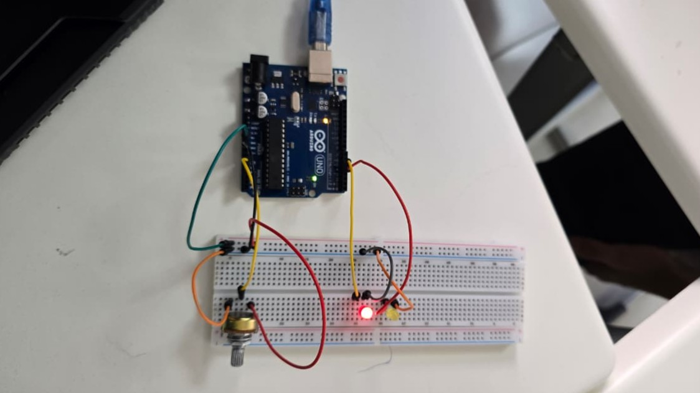
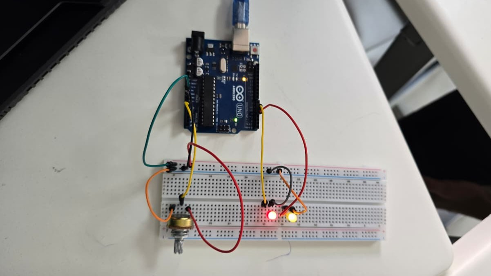

# Experiment 1 — Potentiometer-Controlled LEDs

## Objective
Read a potentiometer through an Arduino Uno analog pin and switch two LEDs according to three ADC ranges. This teaches analog acquisition, threshold comparison, and digital outputs.

## Components
Arduino Uno, potentiometer, 2 LEDs, suitable LED current-limiting resistors, breadboard, jumper wires.

## Wiring
| Component | Arduino connection |
| --- | --- |
| Potentiometer wiper | A0 |
| Potentiometer outer terminals | 5V and GND |
| LED 1 control | D4 (through resistor) |
| LED 2 control | D5 (through resistor) |
| LED cathodes | GND |

## Behavior
| `analogRead(A0)` | LED D4 | LED D5 |
| --- | --- | --- |
| Less than 400 | ON | OFF |
| 400–599 | OFF | ON |
| 600–1023 | ON | ON |

Values are printed to the Serial Monitor at **9600 baud**, once per second. On the Uno, the default ADC reading ranges from 0 to 1023.

## Run
Open `01-potentiometer-led-control.ino` in Arduino IDE, select **Arduino Uno** and the correct port, upload, then rotate the potentiometer and watch the LEDs and Serial Monitor.

## Circuit diagram

## Real-world results

*ADC value below 400.*

*ADC value from 400 to 599.*

*ADC value 600 or above.*

## Notes
The source report's objective paragraph mentions periodic LED blinking, but the experiment and code actually implement **potentiometer-based LED selection**. This README follows the implemented behavior.
