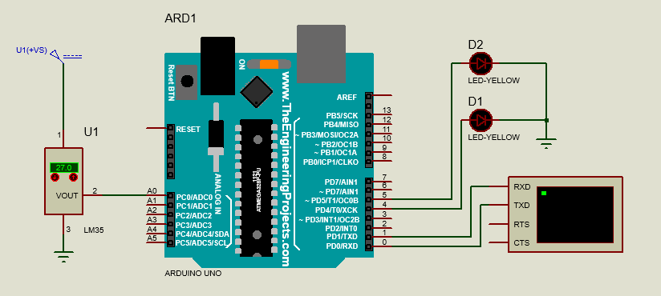
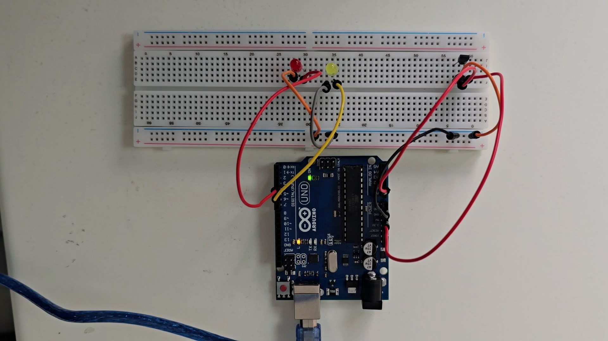
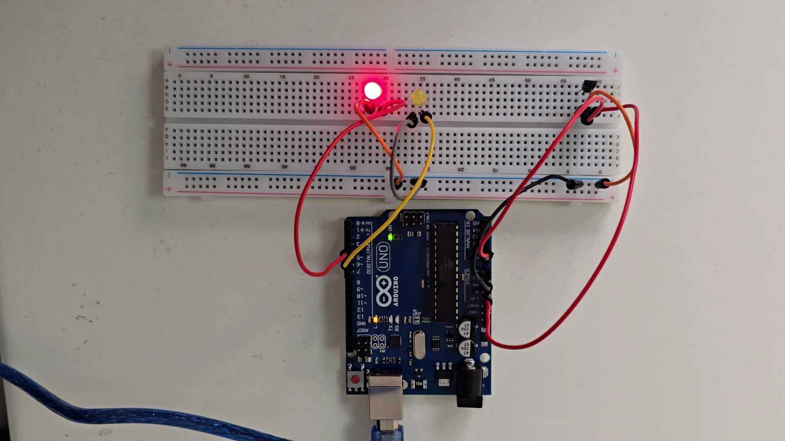
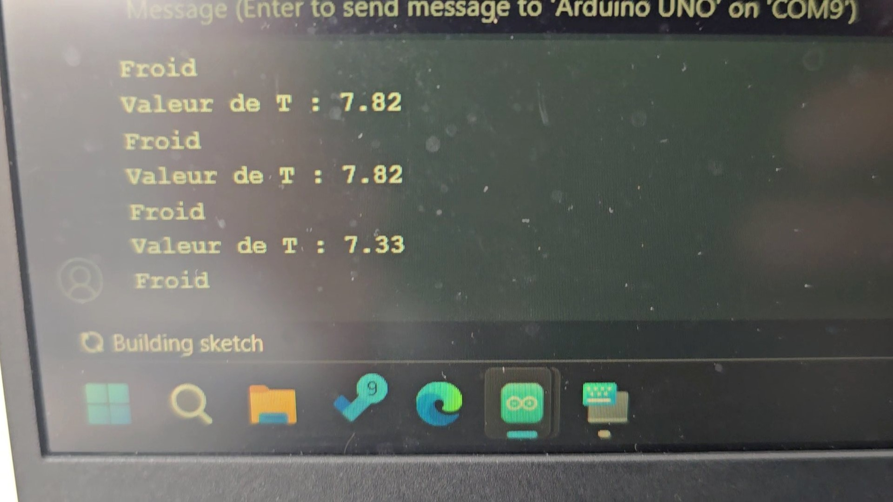
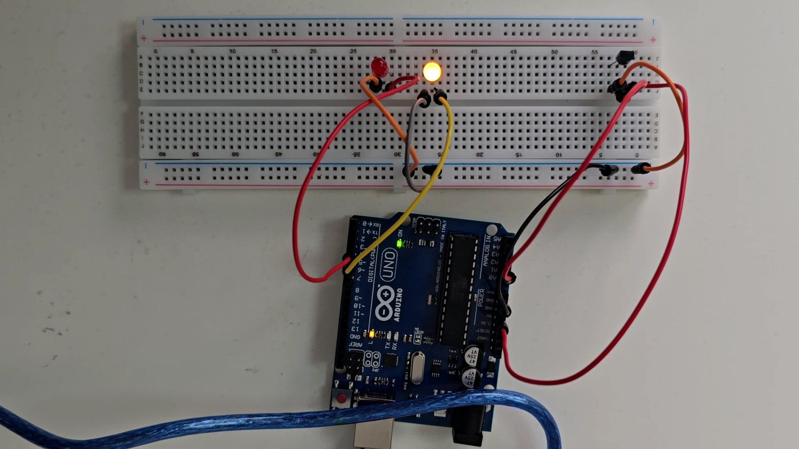
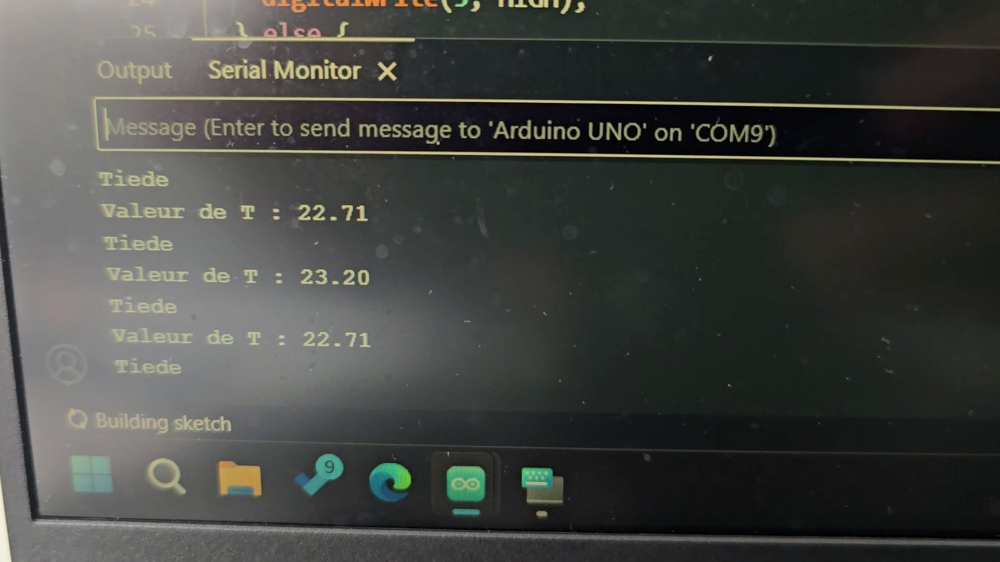
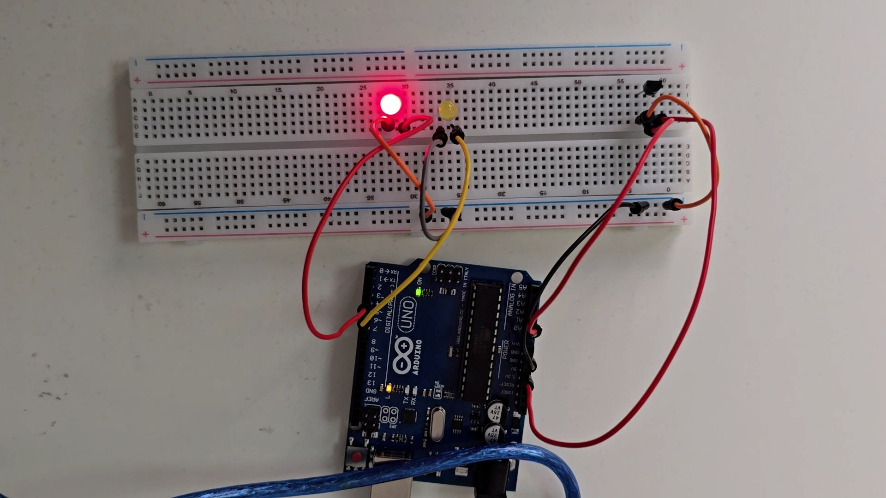
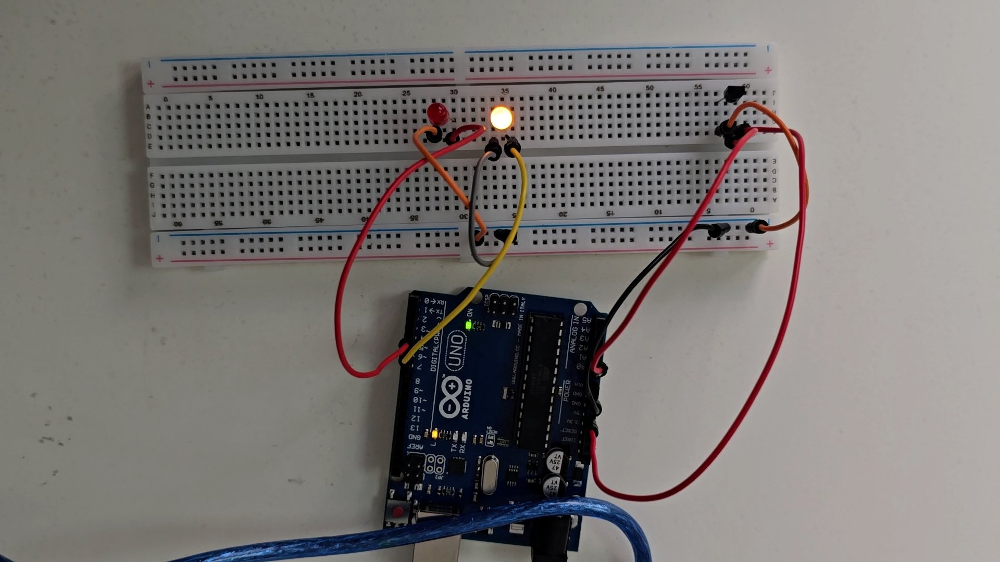
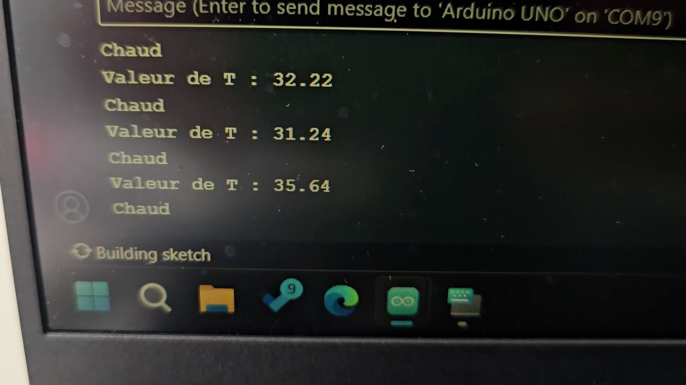

# Experiment 2 — Temperature Classification with LM35

## Objective
Read an LM35 analog temperature sensor, convert its voltage to degrees Celsius, and indicate cold, mild, or hot conditions with LEDs and Serial output.

## Components
Arduino Uno, LM35, 2 LEDs, current-limiting resistors, breadboard, jumper wires.

## Wiring
| Component | Arduino connection |
| --- | --- |
| LM35 analog output | A1 |
| LM35 power and ground | 5V and GND (check the exact sensor package pinout) |
| LED 1 | D4 through resistor |
| LED 2 | D5 through resistor |
| LED cathodes | GND |

## Conversion
The LM35 outputs approximately **10 mV per °C**. With the report's assumed 5 V ADC reference on a 10-bit Arduino Uno:

```text
temperature_C = analogRead(A1) * 5.0 * 100.0 / 1023.0
```

Accuracy depends on the actual analog reference voltage and hardware setup.

## Expected behavior
| Temperature | Classification | LED response |
| --- | --- | --- |
| Below 10 °C | `Froid` (cold) | D4 blinks slowly (2 seconds on, 2 seconds off) |
| 10–30 °C inclusive | `Tiede` (mild) | D5 stays on |
| Above 30 °C | `Chaud` (hot) | D4 and D5 alternate every 500 ms |

All temperatures and classifications are sent to the Serial Monitor at **9600 baud**. Blocking delays mean the sampling rate varies by category.

## Run
Open `02-lm35-temperature-classifier.ino`, select the Uno and serial port, upload, and open Serial Monitor at 9600 baud.

## Circuit diagram


## Real-world results









## Notes
This sketch follows the report's original thresholds and LED timing. It assumes the standard 5 V Uno analog reference. Values close to a threshold can fluctuate because analog measurements contain noise.
