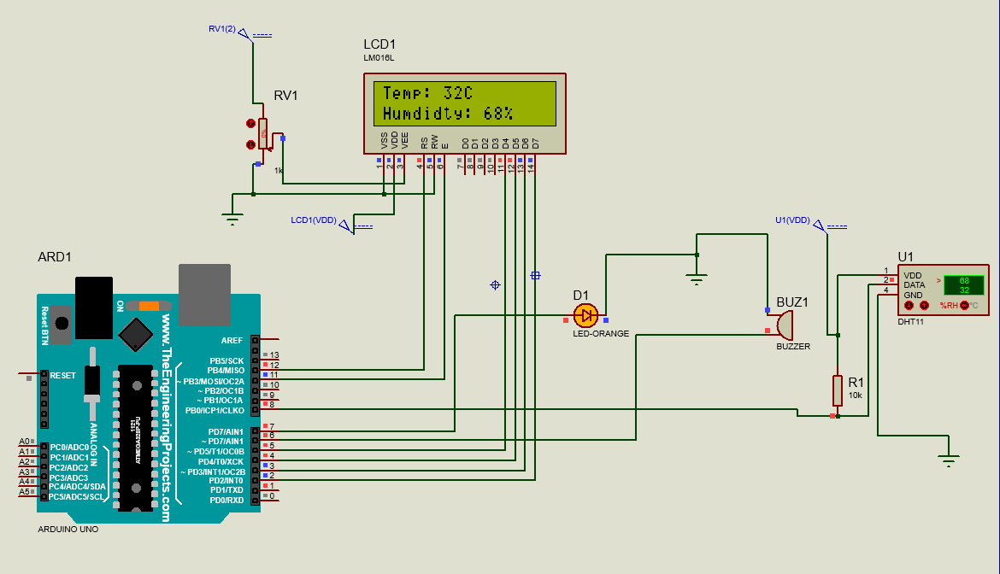
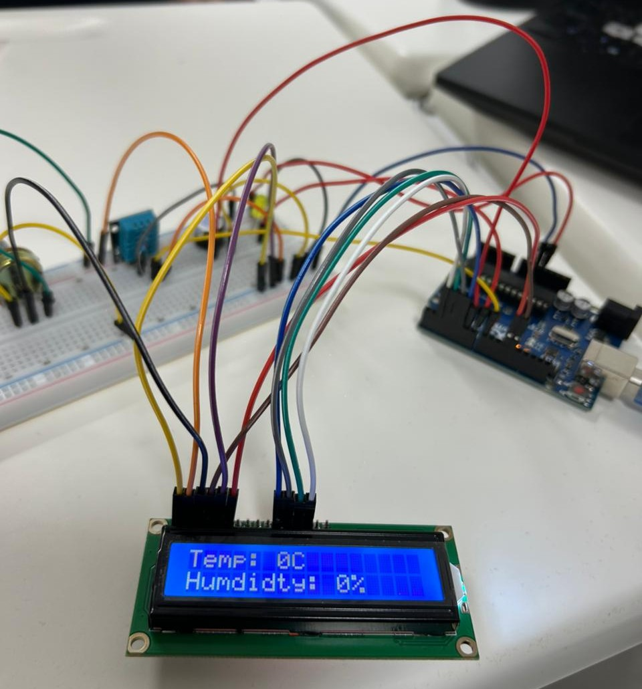
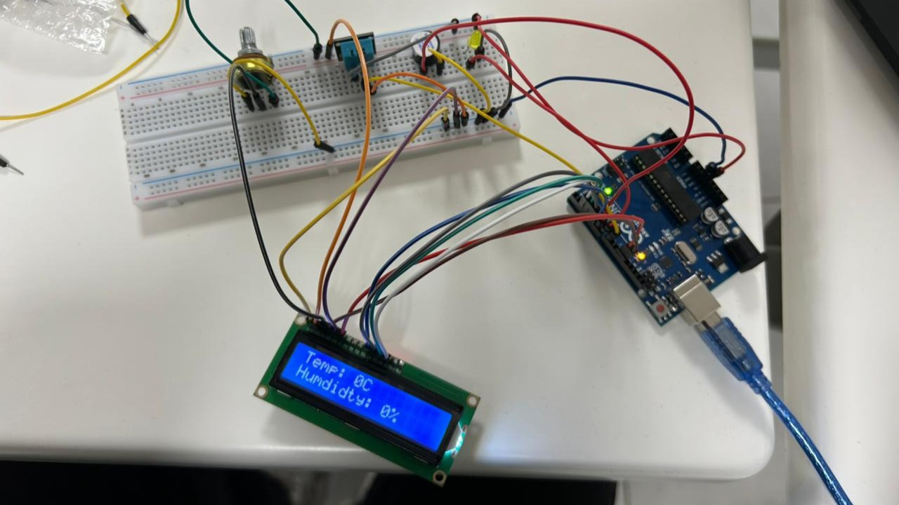
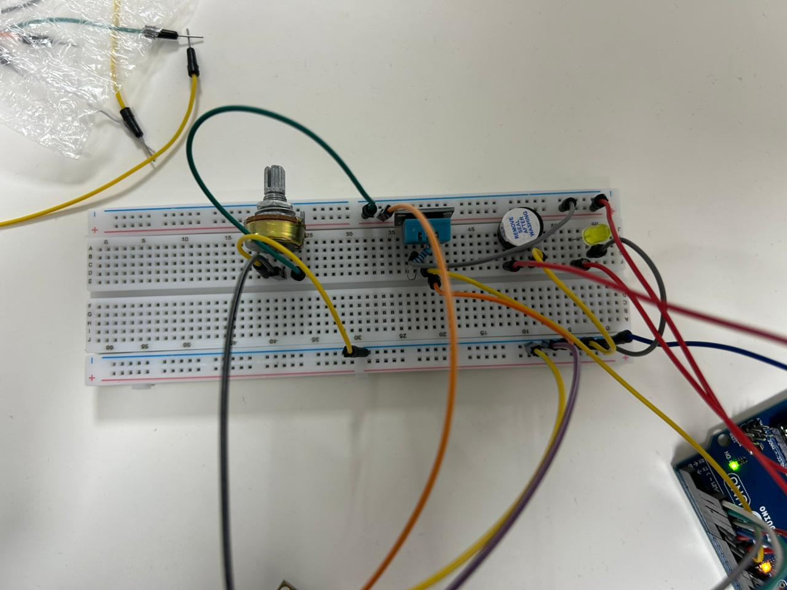

# Experiment 3 — DHT11 + LCD Environmental Alarm

## Objective
Measure temperature and relative humidity with a DHT11, show the readings on a 16×2 LCD, and activate an LED and buzzer when the temperature reaches **30 °C**.

## Components
Arduino Uno, DHT11 module/sensor, 16×2 HD44780-compatible LCD, potentiometer for LCD contrast, LED and current-limiting resistor, active buzzer, breadboard, jumper wires. A bare DHT11 may need a pull-up resistor on its data line; some breakout modules include one.

## Wiring (as specified by the source sketch)
| Component | Arduino connection |
| --- | --- |
| DHT11 data | D8 |
| LCD RS, E, D4, D5, D6, D7 | D12, D11, D5, D4, D3, D2 |
| Alarm LED | D7 |
| Buzzer control | D6 |
| LCD contrast | Potentiometer wiper to VO; outer terminals to 5V and GND |
| Sensor / LCD power | Appropriate 5V and GND connections |

Use the Proteus diagram to complete the LCD power, R/W, backlight and sensor wiring. Check your buzzer's voltage/current rating before connecting it directly to a pin; use a transistor driver if required.

## Behavior
Every two seconds, show the temperature on the first line and humidity on the second. When **temperature ≥ 30 °C**, turn on the LED and buzzer; otherwise keep them off. If the sensor read fails, display an error and switch the alarm outputs off.

## Required libraries
- **DHT sensor library** by Adafruit (Arduino Library Manager)
- **Adafruit Unified Sensor** (dependency of the DHT library)
- **LiquidCrystal** (provided by the Arduino library ecosystem)

## Run
Install the libraries, open `03-dht11-lcd-alert-system.ino`, choose Arduino Uno and upload. Verify normal values appear on the LCD, then test alarm activation safely.

## Circuit diagram

## Real-world results

## Notes and corrections
The report declares temperature and humidity as `int`, then checks them with `isnan()`. This can hide failed readings because NaN is not preserved when converted to an integer. The repository sketch uses **float** readings, checks them before display, and clears the LCD to avoid leftover characters. The report's written explanation says "exceeds 30 °C" in one place; its conditions and code trigger at **30 °C or higher**, which this version preserves.
