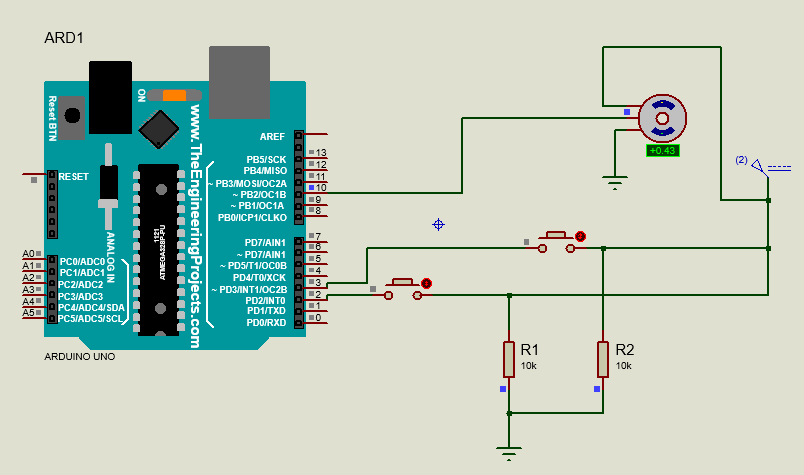
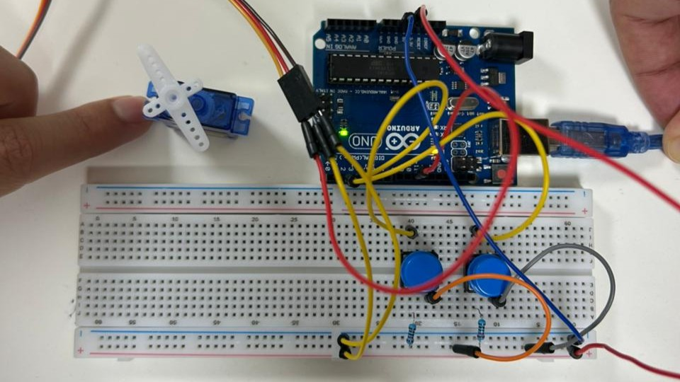
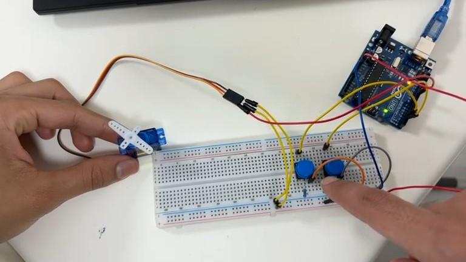
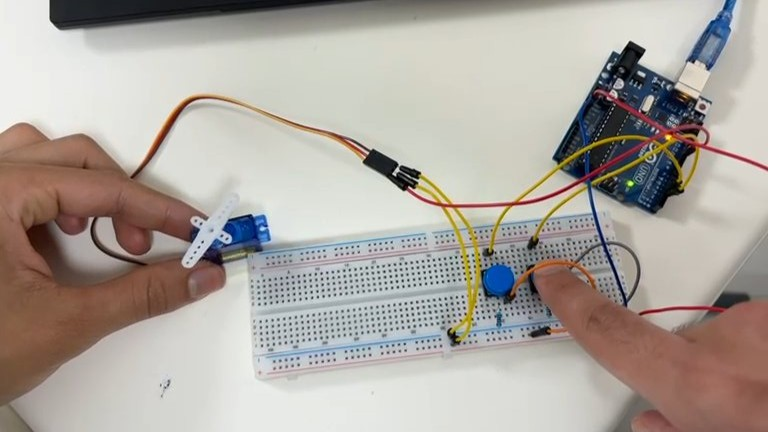

# Experiment 4 — Servo Control Using Two Push Buttons

## Objective
Move a servo motor between two preset angular positions with two buttons on an Arduino Uno.

## Components
Arduino Uno, hobby servo, 2 push buttons, breadboard, jumper wires, 2 external pull-down resistors (as in the report's diagram).

## Wiring (original lab arrangement)
| Component | Arduino connection |
| --- | --- |
| Servo control/signal | D10 |
| Button for 0° | D2 |
| Button for 90° | D3 |
| Buttons | Each button connects its input to 5V when pressed; pull-down resistor holds it at GND otherwise |
| Servo power | Rated supply and GND, with common ground to Arduino |

**Important:** The original sketch uses `INPUT`, not `INPUT_PULLUP`. Keep the external pull-down resistors or the unpressed input pins may float. A servo can draw substantial current, so consider a suitable separate supply and **connect grounds together**. Check your particular servo's supported angle range.

## Behavior
- Press the button connected to D2 to command **0°**.
- Press the button connected to D3 to command **90°**.
- The servo keeps its last commanded angle when no buttons are pressed.
- If both buttons are pressed, the sketch checks D3 first and D2 second, so **0° wins**.

## Run
Open `04-servo-two-button-control.ino`, select Arduino Uno and upload. Connect and test each button. `Servo.h` is the standard Arduino Servo library.

## Circuit diagram

## Real-world results

## Notes
The code follows the lab sketch and expects external pull-down resistors. No debouncing is included, which is generally acceptable for this two-position demo but may matter in more complex designs.
